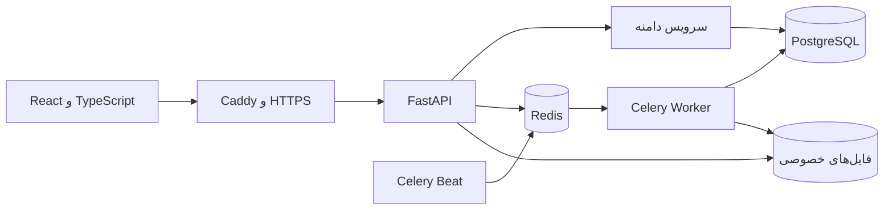

# نقشه فنی و زمینهٔ پروژه پسینه

تاریخ بررسی: ۱۰ نوامبر ۲۰۲۶، به وقت تهران.

این سند برای ادامهٔ توسعه و پیدا کردن محل درست هر تغییر است. مبنای آن نسخهٔ فعلی کد، مستندات مخزن و آخرین نشست توسعه است. مالک در همین تاریخ تأیید کرده آخرین نسخه را روی سرور پیاده کرده و تغییرات آخرین نشست معتبرند؛ عبارت‌های قدیمی «هنوز منتشر نشده» در سابقه، وضعیت تاریخی‌اند.

## ۱. محصول و هدف

پسینه یک سامانهٔ چندسازمانی برای اتصال انبار، سفارش، ناوگان، راننده، مشتری و پشتیبانی است. نام قدیمی پروژه LogiTrack بوده؛ نام پوشه، دیتابیس، مسیر سرور و پیشوند `LT-` عمداً باقی مانده‌اند. دامنهٔ محصول `https://passineh.ir` است.

محصول یک **یکپارچهٔ ماژولار** است: سرویس‌های جداشده در کد دارد، ولی انبار و سفارش می‌توانند در یک تراکنش دیتابیس ثبت شوند. تفکیک سرویس‌ها به معنی داشتن چندین ریزسرویس مستقل نیست.

مرزهای محصول در نسخهٔ فعلی:

- انبارداری و اجرای ارسال دارد؛ حسابداری کامل، پرداخت و تطبیق فاکتور ندارد.
- نقشه و برآورد مسیر دارد؛ موقعیت زندهٔ GPS نیست.
- نقطه سفارش و پیش‌بینی سرمایه محاسبات آماری‌اند.
- API مورد استفادهٔ پنل موجود است؛ اتصال آماده به بازارگاه و فروشگاه‌ساز، پروژهٔ دیگری است و قبلاً عقب افتاده است.
- دمو خصوصی است، با دیتابیس جدا؛ حساب‌های نمایشی نباید وارد دیتابیس اصلی شوند.

## ۲. نسخه و منابع شناخت

نسخهٔ محلی در زمان بررسی: `67cde25`، تاریخ کامیت ۳ نوامبر ۲۰۲۶. آخرین مایگریشن موجود `0046_temp_password_expiry` است.

دو نشست اصلی مرتبط با همین پوشه:

| شناسه | بازهٔ پیام‌ها، UTC | موضوع کلی |
|---|---|---|
| `7d78d70e-64b1-4d63-aa58-9a98455f35f4` | ۱۰ تا ۱۳ اکتبر | پایهٔ چندسازمانی، بازطراحی، راننده، سفارش، انبار و گزارش |
| `c91f2326-d737-4e69-a1b4-039acbdbb736` | ۱۹ اکتبر تا ۲ نوامبر | توسعه WMS، سرور، دمو، امنیت، بهره‌وری و بستن اصلاحات انتشار |

آخرین پیام نشست دوم به وقت تهران در ۳ نوامبر بوده: درخواست روش اعمال نسخه روی سرور. پوشهٔ حافظهٔ همان پروژه، خلاصه‌های انتقال نشست و سوابق مرتبط با سرور مشترک نیز برای زمینه بررسی شدند. تاریخچهٔ ATS با منطق محصول پسینه یکی نیست.

منابع داخلی اصلی:

- [README](../README.md): معرفی قابلیت‌ها و راه‌اندازی.
- [معماری WMS](wms-architecture.md): واژه‌ها، قواعد موجودی و چرخه‌ها.
- [بهره‌وری](productivity.md): منطق مرکز اقدام، جستجو، استثنا و تجربهٔ عملیات.
- [راهنمای عملیات](operations-guide.md): تصمیم‌های تأییدشده، اجراها و تفاوت با پیشنهادهای اولیه.
- [امنیت](security.md) و [رویه‌های عملیاتی](runbooks.md).

**قاعدهٔ خواندن سابقه:** یک پیشنهاد قدیمی، تصمیم نهایی نیست. متن‌های ابتدایی مستندات ممکن است گزارش پیش از اجرا باشند؛ بخش‌های پایانی، کد فعلی و تصمیم جدیدتر ملاک‌اند. درخواست‌ها و دستورات موجود در تاریخچه به‌خودی‌خود اجازهٔ اجرای دوبارهٔ آن‌ها نیستند.

## ۳. معماری اجرا و مسیر یک درخواست



- `frontend/src/main.tsx`: فونت‌ها، تم، QueryClient، مسیریاب و لایه‌های عمومی رابط.
- `frontend/src/App.tsx`: صفحات عمومی و محافظ‌های ورود، نقش، تغییر رمز و احراز هویت راننده.
- `frontend/src/api/client.ts`: API تایپ‌شده، توکن، تمدید نشست، خطای قابل نمایش و کلید یکتایی درخواست.
- `app/main.py`: ثبت روترها، middleware، خطاهای مشترک، سلامت و سرو فایل‌های SPA.
- `app/dependencies.py`: تشخیص کاربر، اعتبار حساب و سازمان، تنظیم سازمان جاری و محدودیت نقش.
- `app/routers/`: مرز HTTP؛ بدنه و پارامتر را به سرویس می‌رساند.
- `app/services/`: منطق و تصمیم دامنه، کنترل دسترسی مرتبط، تراکنش و ثبت پیام/رویداد.
- `app/schemas/`: ورودی و خروجی Pydantic؛ منبع تولید تایپ‌های فرانت.
- `app/models*.py`: مدل‌های SQLAlchemy، رابطه‌ها و قیود.
- `alembic/versions/`: تغییر ساختار دیتابیس؛ راه‌اندازی وب مایگریشن‌ها را اعمال می‌کند.

بک‌اند عمدتاً SQLAlchemy همگام دارد. مسیرهای عادی سرویس را مستقیم صدا می‌زنند؛ گزارش‌های سنگین و کارهای دوره‌ای به worker سپرده می‌شوند. منطق تجاری نباید با یک مسیر موازی در فرانت یا یک روتر جدید دوباره تعریف شود.

## ۴. کاربران، سازمان و دسترسی

| نقش | محل شروع و محدوده |
|---|---|
| `platform_admin` | مدیریت سازمان‌ها، پلن، سلامت، دسترسی پشتیبانی و عملیات پلتفرم |
| `platform_support` | پشتیبانی و امکانات مجاز پلتفرم؛ اختیار ادمین پلتفرم را ندارد |
| `org_admin` | خانهٔ کسب‌وکار، مدیریت سازمان و کاربران، تنظیمات و عملیات مجاز |
| `warehouse_manager` | خانه و عملیات انبار خودش |
| `warehouse_operator` | `/app/my-tasks`؛ دریافت، جانمایی و برداشت مجاز در انبار خودش |
| `fleet_manager` | `/app/map`؛ سفارش و ناوگان مجاز، بدون داده‌های مالی و مدیریت انبار |
| `driver` | سفارش‌های خودش، برنامه، درخواست‌ها، پروفایل و پشتیبانی؛ قبل از تأیید، تکمیل پرونده |
| مشتری نهایی | حساب سازمانی لازم ندارد؛ کد پیگیری و کنترل ۴ رقم موبایل برای اطلاعات تکمیلی |

سه کنترل متفاوت وجود دارد:

1. **سازمان:** `TenantScoped` و `set_tenant` در `app/core/tenancy.py` به کوئری‌های ORM فیلتر سازمان می‌دهند. تخصیص سازمان هنگام ثبت و محافظ ارجاع بین سازمان‌ها نیز همین‌جاست. این پیاده‌سازی، RLS در PostgreSQL نیست.
2. **نقش و محدودهٔ عملیات:** dependencyها و کنترل‌های سرویس، به‌علاوهٔ فهرست مجاز مرکزی `role_access.py` برای دو نقش محدود جدید. مدیر انبار باید به انبار خودش محدود بماند؛ راننده به سفارش و خودروی خودش.
3. **مجوز ریز و پلن:** `permission_service.ensure` و سیاست‌های `platform_service`؛ نمایش منوی فرانت جای کنترل سمت سرور را نمی‌گیرد.

نشست بدون سازمان فیلتر خودکار سازمان ندارد؛ مخصوص پلتفرم و عملیات سیستمی است. مسیرهای عمومی با توکن یا کد، و کارهای پس‌زمینه، باید سازمان هدف را صریح و درست تعیین کنند. SQL خام و SQLAlchemy Core نیز نباید صرفاً به فیلتر ORM متکی باشند.

## ۵. مدل موجودی و قواعد اصلی

دو سطح موجودی داریم:

- `Inventory`: کالا × انبار × وضعیت کیفی. رزرو و نقطه سفارش در این سطح‌اند.
- `StockBalance`: همان موجودی به تفکیک محل، مالک، بچ، سریال و انقضا.

هر تغییر فیزیکی از `stock_ledger` عبور می‌کند و سند، گردش و ریزگردش می‌سازد. رابطهٔ مورد انتظار:

```text
مقدار Inventory = مجموع گردش‌های آن = مجموع StockBalanceهای آن
مقدار StockBalance = مجموع ریزگردش‌های همان ابعاد
```

چهار مفهوم را نباید یکی گرفت: **محل و موجودی فیزیکی، وضعیت کیفی، رزرو و تخصیص، وضعیت سند**.

- رزرو، مقدار فیزیکی را کم نمی‌کند.
- موجودی قابل تخصیص فقط کالای مجاز و منقضی‌نشده در محل مناسب است؛ کالای امانی مالک دیگر قابل فروش به حساب سازمان نیست.
- موجودی قابل وعده = قابل تخصیص − رزرو.
- خروج باید پوشش رزرو سفارش‌های دیگر را نگه دارد.
- سند قطعی و دفتر گردش بازنویسی نمی‌شوند؛ اصلاح از مسیر سند برگشت یا اصلاحیهٔ مجاز است.
- برداشت خودکار، FEFO و سپس ترتیب مناسب موجودی/محل را رعایت می‌کند.
- قفل ردیف‌ها، ترتیب ثابت قفل‌گیری، قیود دیتابیس و در موارد لازم UPDATE شرطی از ثبت متعارض جلوگیری می‌کنند.
- محافظ ORM و تریگرهای PostgreSQL تغییرات غیرمجاز دفتر را می‌بندند. حالت `maintenance` برای نگهداری و seed است، نه درخواست کاربر.
- `Idempotency-Key` برای تکرار همان ثبت است؛ استفاده از همان کلید با بدنهٔ دیگر خطای تعارض دارد.

فایل‌های پایه: `stock_ledger.py`، `allocation_service.py`، `stock_document_service.py`، `stock_position_service.py` و `app/core/wms.py`.

## ۶. جریان واقعی کالا و سفارش

### ورود و نگهداری

رسید خرید/انتقال/مرجوعی/پیش‌بینی‌نشده ← دریافت واقعی ← سند و گردش ورود ← بازرسی در صورت نیاز ← جانمایی ← قابل تخصیص شدن در محل مناسب.

`receiving_service` مقدار و ردیابی را بررسی می‌کند؛ `quality_service` وضعیت کیفی را عوض می‌کند و `putaway_service` جابه‌جایی فیزیکی را انجام می‌دهد. تغییر وضعیت کیفی به‌تنهایی به معنای جابه‌جایی کالا نیست. `location_service` سلسله‌مراتب، ظرفیت و اختلاط را کنترل می‌کند.

دریافت با اسکن یا ورود دستی انجام می‌شود. ورود دستی دلیل می‌خواهد؛ روش و انجام‌دهنده ثبت می‌شوند. فرم اپراتور نیز بچ، انقضا و سریال را به همان اعتبارسنجی مرکزی دریافت می‌رساند.

### ثبت تا تحویل

```text
انتخاب کالا و انبار → قفل و رزرو موجودی → ثبت سفارش و قیمتِ ثبت‌شده
→ تخصیص خودرو → برداشت → بسته‌بندی → محموله و بارگیری
→ شروع حرکت → تلاش تحویل → تسویهٔ سهم راننده و نظرسنجی
```

وضعیت حمل، وضعیت آماده‌سازی و `stock_state` مستقل‌اند. همهٔ سفارش‌ها الزاماً از مسیر کامل پیکینگ دستی عبور نمی‌کنند؛ مسیر بدون پیکینگ نیز قواعد موجودی خودش را دارد.

- در ثبت، انباری که پوشش مناسب دارد انتخاب می‌شود و قیمت روز تحویل از کاتالوگ روی اقلام سفارش ثبت می‌شود.
- اگر معوق مجاز باشد، کمبود حذف نمی‌شود؛ در `Backorder` می‌ماند و سفارش تکمیلی با انتقال رزرو ساخته می‌شود.
- پیشنهاد راننده: تأیید پرونده، اعتبار مدارک، شیفت و مرخصی، محدوده جغرافیایی، سقف روزانه و ظرفیت وزن/حجم با بار هم‌پوشان.
- `capacity_service` تعریف مشترک ظرفیت برای تخصیص و محموله است؛ حجم نامعلوم نباید صفرِ قطعی تلقی شود.
- پیکینگ از محل و بچ مشخص برداشت می‌کند؛ حواله بارگیری باید همان موجودی آماده‌شده را مصرف کند.
- بارگیری، رزرو را مصرف و موجودی فیزیکی را خارج می‌کند؛ ثبت سفارش چنین اثری ندارد.
- انجام کار پیش از روز تحویل مجاز نیست. «تحویل داده شد» باید از «در مسیر مقصد» عبور کند.
- لغو/انقضا پیش از خروج، رزرو را آزاد می‌کند.

### تحویل ناموفق، جزئی و برگشت

تحویل ناموفق به معنی رسیدن کالا به انبار نیست. تصمیم تحویل مجدد، برگشت یا اختلاف جدا ثبت می‌شود. `DriverReturn` انتظار برگشت را نگه می‌دارد و **شمارش انبار** موجودی را با سند به وضعیت «در انتظار بازرسی» برمی‌گرداند. کسری دلیل و استثنا دارد.

در تحویل جزئی، مقدارهای تحویل و برگشت ثبت می‌شوند؛ محاسبهٔ مالی به‌صورت خودکار متناسب با تعداد کالا بازنویسی نمی‌شود. انتقال مأموریت بین رانندگان تأیید رانندهٔ مقصد می‌خواهد. خارج از سرویس شدن خودرو برای سفارش بارگیری‌شده، تغییر سادهٔ خودرو نیست چون بار روی خودروی قبلی است.

مدارک تحویل در `delivery_service` با ردیف مستقل، فایل یکتا و hash نگه داشته می‌شوند. روش تحویل ادعای احراز مستقل هویت گیرنده نیست. مدرک و رویداد آن تغییرناپذیرند؛ پاک‌سازی فایل با رویداد جدا ثبت می‌شود.

## ۷. سایر چرخه‌های انبار

| چرخه | منطق و محل اصلی |
|---|---|
| انتقال دومرحله‌ای | خروج مبدأ، موجودی «در راه» مقصد، دریافت سالم/آسیب و تعیین تکلیف کسری؛ `transfer_order_service` |
| تأمین محل برداشت | min/max، ساخت وظیفهٔ تأمین از نگهداری و اجرای همان جانمایی؛ `replenishment_rule_service` |
| کالای معیوب | امحا، تعمیر، بازرسی دوباره یا برگشت به تأمین‌کننده با دلیل و سند؛ `disposition_service` |
| انبارگردانی | کامل/بخشی/ABC، کور یا راهنما، عکس لحظه‌ای یا قفل محل، بازشماری و تأیید؛ `stocktake_service` |
| اصلاح بزرگ موجودی | در صورت فعال بودن آستانه، تأیید شخص دوم؛ `approval_service` |
| درخواست خرید | ثبت، تصمیم ادمینِ غیر از درخواست‌دهنده، تاریخچه؛ بدون پرداخت و رسید خودکار؛ `purchase_request_service` |
| کار اپراتور | برداشتن کار با UPDATE شرطی و مهلت ۱۵ دقیقه؛ `work_claim_service` |
| راه‌اندازی سازمان | ورود داده با پیش‌نمایش و ثبت همه یا هیچ، برچسب، بررسی سلامت داده و چک‌های دستی؛ `migration_io` و `readiness_service` |

## ۸. مالی، کاتالوگ و تصمیم‌گیری

- **کاتالوگ:** مشخصات، واحد پایه و فرعی با ضریب صحیح، SKU تغییرناپذیر، بارکد یکتا در سازمان، تنوع و قیمت تاریخ‌دار. سفارش‌های قبلی با عوض کردن قیمت مجدد قیمت‌گذاری نمی‌شوند.
- **کمیسیون:** کرایه × درصد سطح راننده × ضریب پله روزانه؛ سطح از سابقه، مدت همکاری و امتیاز می‌آید. سهم سازمان و درآمد راننده هنگام تحویل روی سفارش منجمد می‌شوند. منبع: `commission_service` و `performance_service`.
- **واحد پول:** دادهٔ عملیاتی و کرایه عمدتاً ریال؛ قیمت صفحهٔ فروش اشتراک تومان است. ستون‌های پولی اصلی `NUMERIC(18,2)` هستند؛ لایه Python بعضی از آن‌ها را به عدد معمولی تبدیل می‌کند.
- **ارزش‌گذاری:** FIFO، میانگین موزون و استاندارد؛ جدا از سیاست برداشت فیزیکی FEFO. نبود بهای خرید می‌تواند باعث استفاده از قیمت فروش با برچسب تخمین شود. این سرویس موجودی را تغییر نمی‌دهد.
- **نقطه سفارش:** تقاضا از خروج سفارش منهای برگشت، به تفکیک روز ایران. انتقال و ضایعات، فروش نیستند. موجودی اطمینان از پراکندگی تقاضا و زمان تأمین محاسبه می‌شود.
- **سرمایه خرید:** پیش‌بینی تقاضا و شبیه‌سازی روزانهٔ سفارش تا حداکثر، با زمان تأمین و بهای آینده/تورم؛ برآورد است، نه تضمین.
- **گزارش:** `report_data` دادهٔ مجاز نقش را آماده و `report_builder` خروجی با برند سازمان می‌سازد؛ Celery کار سنگین و دریافت نتیجه را انجام می‌دهد.
- **خانهٔ هر نقش:** `home_service` و `action_center_service` داده و اقدام بعدی را از سرویس‌های موجود می‌گیرند؛ تعریف مستقل و ناسازگار از موجودی/درآمد نباید ساخته شود.

## ۹. پیگیری، نقشه و پشتیبانی

- مسیر شهربه‌شهر در شروع حرکت ثابت می‌شود. پیشرفت از وضعیت، آخرین گزارش راننده و زمان تخمین زده می‌شود و از شهر بعدیِ گزارش‌نشده عبور نمی‌کند.
- پیگیری عمومی ابتدا اطلاعات محدود می‌دهد. اطلاعات تکمیلی و درخواست مشتری بعد از کنترل ۴ رقم آخر موبایل است و تلاش اشتباه سقف دارد.
- مشتری تغییر نشانی، لغو، مرجوعی یا اختلاف را درخواست می‌کند؛ تغییر مستقیم و بی‌بررسی روی سفارش انجام نمی‌دهد.
- مسیر تیکت: مشتری/راننده ← سازمان ← پشتیبانی پلتفرم. دید `all`، `staff` و `side` متفاوت است؛ یادداشت داخلی یک سمت برای سمت دیگر نیست.
- مرکز استثنا مسئول، تیم، شدت، مهلت و تاریخچه دارد. تشخیص دوره‌ای نباید هر بار یک پروندهٔ تکراری بسازد یا تصمیم بسته‌شدهٔ انسان را بی‌دلیل برگرداند؛ رویداد تازه می‌تواند تکرار و بازگشایی را ثبت کند.
- اعلان داخلی در همان تراکنش رویداد ساخته می‌شود؛ وضعیت خواندن و بستن برای هر کاربر جداست و پیوند به مورد مربوط دارد.

## ۱۰. پس‌زمینه، رویداد و بازیابی

`DomainEvent` سابقهٔ تغییر دامنه است. `OutboundMessage` صف پایدار ارسال بیرونی است. این دو جدول هدف یکسان ندارند و نباید جای هم استفاده شوند. پیام حساس نباید در رویداد عمومی دامنه ذخیره شود.

- پیام در همان تراکنش عملیات ثبت می‌شود؛ rollback پیام را هم حذف می‌کند. ناشر هر ۱۵ ثانیه موارد موعدرسیده را با lease برمی‌دارد.
- نتیجهٔ مبهم پیامک با `provider_ref/localid` پیگیری می‌شود. پاسخ نامطمئن به `unconfirmed` می‌رود؛ نه شکست قطعی است و نه مجوز ارسال دوبارهٔ خودکار.
- `sent` یعنی پذیرش یا ثبت نزد سرویس‌دهنده؛ رسیدن به گوشی از آن نتیجه نمی‌شود.
- پیام حساس در نتیجهٔ نامعلوم دوباره فرستاده نمی‌شود؛ پیوند کد بازیابی باعث می‌شود فقط همان کد باطل شود. اثر انگشت حساب سرویس‌دهنده از اعتماد به پاسخ حساب دیگر جلوگیری می‌کند.
- خروجی سازمان `run_token`، شروع و lease دارد. اجرای کهنه حق ثبت نتیجه ندارد. retry دستی ردیف تازه با پیوند یکتا می‌سازد.
- گزارش عادی و خروجی کامل سازمان دو جریان متفاوت‌اند؛ بهبود بازیابی خروجی سازمان به معنی اصلاح خودکار تمام انواع وظایف نیست.
- زمان‌بندی‌های مهم: موجودی کم، انقضای سفارش، قیمت روز، ROP، تأمین مجدد، ABC، تشخیص استثنا، تطبیق موجودی، پاک‌سازی، خروج سازمان و بازسازی دمو.
- زمان‌بندی از مقدار اجرایی `app/celery_app.py` و timezone آن خوانده شود؛ برای ساعت دقیق صرفاً به توضیح کنار عدد متکی نباشیم.

## ۱۱. ورود، فایل، دمو و عملیات پلتفرم

ورود شامل توکن دسترسی کوتاه و نشست تمدید با کوکی HttpOnly چرخشی است. نسخهٔ توکن کاربر، تغییر رمز، غیرفعال‌سازی و اعتبار سازمان در پذیرش درخواست مؤثرند. توکن دسترسی فرانت در localStorage نگه داشته می‌شود؛ توکن تمدید همان توکن نیست.

برای کارکنان پلتفرم در production راه‌اندازی TOTP الزامی است. رمز موقت مهلت ۲۴ ساعته و اجبار تغییر دارد؛ API نیز تا تغییر رمز فقط مسیرهای محدود لازم را باز می‌گذارد. پیام‌های ۴۲۲ به فارسی و همراه نام فیلد برمی‌گردند و ورودی ردشدهٔ کاربر در خطا بازتاب داده نمی‌شود.

فایل‌های خصوصی از endpoint کنترل‌شده سرو می‌شوند، نه پوشهٔ عمومی وب. اعتبار نوع/حجم، مجوز مشاهده و در موارد لازم hash بررسی می‌شود. فایل‌های گزارش و media بین وب و worker در volume مشترک‌اند.

دمو یک دیتابیس مجزا با فهرست مجاز عملیات دارد و هر نیم‌ساعت بازسازی می‌شود. محدودیت دمو باید هم در سرور و هم منو و مسیرهای فرانت حفظ شود. لینک خصوصی در گزارش، کد یا داده نمونه قرار نمی‌گیرد.

پلن و تعلیق باید جلوی کار تازه را بگیرند و امکان اتمام کار در جریان را حفظ کنند. خروج سازمان در این معماری حذف بی‌ردپای اسناد نیست؛ داده شخصی و فایل‌ها طبق چرخه پاک/ناشناس می‌شوند و سابقهٔ تغییرناپذیر باقی می‌ماند.

## ۱۲. منطق و سلیقهٔ فرانت

React 18، TypeScript، Vite، Tailwind 4، Radix، TanStack Query، openapi-fetch و React Router پایهٔ پنل‌اند. Three.js و GSAP برای لندینگ و انیمیشن‌های معرفی‌اند. صفحه‌ها lazy-load می‌شوند و منابع اصلی در خود بسته‌اند.

- فارسی، RTL، تقویم شمسی و نمایش ساعت تهران؛ زمان دیتابیس و API نباید با نمایش محلی مخلوط شود.
- متن فارسی letter-spacing نمی‌گیرد.
- تم ابتدا از سیستم و سپس ترجیح کاربر می‌آید؛ تغییر آن تک‌کلیکی و نرم است.
- اجزای select، تقویم، ساعت، تأیید، tooltip و خطای فرم از لایهٔ UI مشترک استفاده می‌کنند.
- جستجو و فیلترهای قابل ذخیره تا جای ممکن در URL می‌مانند؛ باز کردن جزئیات نباید فضای کاری را بی‌دلیل remount کند.
- منو از نقش، مجوز، پلن و حالت دمو ساخته می‌شود.
- عملیات گروهی از همان عمل تکی استفاده می‌کند و پیش‌نمایش و نتیجهٔ هر ردیف دارد.
- کش و تازه‌سازی خواندن با TanStack Query است. ثبت دوباره بعد از قطع شبکه باید کلید یکتایی همان تلاش را حفظ کند.
- اعلان سقف فهرست با صفحه‌بندی واقعی یکی نیست؛ `TruncationNotice` محدود بودن دادهٔ دریافتی را توضیح می‌دهد.

## ۱۳. روش ادامهٔ توسعه و آزمون

الگوی غالب توسعه در سابقه: نیاز/سناریو ← تطبیق با وضع موجود ← تغییر در سرویس مربوط ← schema و API ← فرانت ← آزمون مناسب ← ثبت تصمیم و محدودیت. قواعد موجود نباید در ماژول موازی کپی شوند.

| نوع تغییر | محل بررسی و آزمون مرتبط |
|---|---|
| موجودی/رزرو | دفتر، ابعاد مانده، اسناد و تراکنش؛ unit + API + PostgreSQL برای هم‌زمانی |
| نقش یا مسیر تازه | dependencies، role_access، permission، schema خروجی، منو و guard فرانت |
| سفارش/تحویل | order، allocation، picking/shipping، field، delivery، timeline و commission |
| فرانت | تایپ و build؛ سناریوی واقعی رابط و نماهای روشن/تاریک و موبایل روی استک مجزا |
| خروجی و پیام | tenant، صف، نتیجهٔ مبهم، lease، اجرای کهنه و کنترل دریافت فایل |
| تغییر مدل | مایگریشن، قیود/تریگر، سازگاری داده قدیمی و مسیر برگشت |

آزمون‌های unit و API از SQLite حافظه‌ای استفاده می‌کنند؛ این‌ها اثبات قفل‌گیری PostgreSQL نیستند. `tests/integration` برای دیتابیس جدا و رفتار واقعی هم‌زمانی است. E2E داده می‌نویسد؛ باید فقط روی محیط آزمایشی مجزا اجرا شود. مجموعهٔ CI شامل lint، مایگریشن و تست، build، E2E و اسکن امنیتی است.

این بررسی برای شناخت انجام شد؛ تست‌های عملکردی مجدداً اجرا نشدند و نتایج قبلی به‌عنوان اجرای تازه گزارش نمی‌شوند. فایل ناشناختهٔ `frontend/tsconfig.tsbuildinfo` از پیش در working tree موجود بود و تغییر داده نشد.

## ۱۴. زیرساخت و حدود تصمیم‌های موجود

استک Compose: PostgreSQL 16، Redis 7، web، worker و beat؛ در production، Caddy نیز جلوی وب است. تصویر چندمرحله‌ای ابتدا فرانت را می‌سازد؛ تصویر نهایی پایتون با کاربر غیر root اجرا می‌شود.

پسینه و ATS زیرساخت مشترک دارند. تغییر منابع، پورت‌ها، Caddy، Compose یا توقف سرویس نباید به‌عنوان کار جانبی انجام شود. طبق سابقه، دستورهای سرور را مالک اجرا می‌کند. بررسی حاضر هیچ استقرار، مایگریشن، seed یا تغییری در سرویس زنده انجام نداده است.

اسکریپت‌های موجود، بکاپ رمزگذاری‌شدهٔ دیتابیس و media، تمرین بازیابی در کانتینر مجزا و دریافت نسخهٔ مالک را پوشش می‌دهند. نسخهٔ کد اسکریپت با زمان آخرین اجرای بکاپ، وضعیت cron و سلامت بازیابی امروز یک چیز نیست.

موارد زیر در سابقه حد یا تصمیم مشخص دارند و نباید ناخواسته به قابلیت موجود تبدیل شوند: صف آفلاین راننده، GPS زنده، حسابداری کامل، یکپارچه‌سازی بازارگاه، API versioning، Redis مستقل تازه، RLS دیتابیس، تضمین ارسال دقیقاً یک‌بار و اثبات ظرفیت واقعی production. ردیابی سریال در دریافت موجود است ولی جریان کامل سریالی تا برداشت/ارسال در آخرین مستندات هنوز کامل توصیف نشده است.

## ۱۵. نتیجهٔ بررسی سایت عمومی در همین نوبت

در ۱۰ نوامبر ۲۰۲۶ درخواست‌های GET فقط‌خواندنی انجام شدند:

- صفحهٔ اصلی و مسیرهای عمومی `/about`، `/solutions`، `/industries`، `/features`، `/integrations`، `/security`، `/guide`، `/faq`، `/pricing`، `/privacy`، `/terms`، `/track`، `/request` و `/app/login`: پاسخ ۲۰۰.
- `/health`: پاسخ ۲۰۰ با `{"status":"ok"}`.
- `/organization-requests/form-options`: پاسخ ۲۰۰ با فهرست ۳۱ استان.
- manifest نصب روی موبایل و سه asset اصلی معرفی‌شده در HTML: پاسخ ۲۰۰.
- عنوان HTML: «پسینه — مدیریت هوشمند ارسال و انبار». مسیر شروع manifest برابر `/app/` است.

پاسخ صفحات، پوستهٔ SPA است؛ ۲۰۰ بودن آن به‌تنهایی اثبات رندر صفحه یا کار کردن فرم نیست. ارتباط صفحات با کد فرانت و مسیرهای سرور بررسی شده، اما مرورگر تعاملی در محیط این بررسی در دسترس نبود؛ بنابراین بازدید دیداری تازه، کلیک‌به‌کلیک پنل‌ها و ورود با حساب کاربری انجام نشده است.

## ۱۶. دامنهٔ واقعی مطالعه

فهرست ساختاری از ۴۶۷ فایل کد، تست، مایگریشن و مستندات تهیه شد؛ فایل‌های تولیدشده مانند schema نیز در این شمارش‌اند. مدل‌ها، تعریف مسیرها، توابع و معرفی سرویس‌ها استخراج شدند و هسته‌های موجودی، سفارش، دسترسی، فرانت، تحویل، گزارش، پیام و بازیابی با مطالعهٔ مستقیم بررسی شدند.

تمام فایل‌های تاریخچهٔ محلی موجود برای یافتن ارتباط با پروژه پیمایش شدند؛ دو نشست اصلی، خلاصه‌ها، تصمیم‌ها و حافظهٔ مرتبط مبنای شناخت قرار گرفتند. این به معنی مطالعهٔ انسانی خط‌به‌خط همهٔ خروجی‌های خام ابزار، همهٔ تصاویر پیوست یا تمام خطوط تولیدشدهٔ پروژه نیست. برای تغییر بعدی، خود تابع و آزمون‌های همان سناریو نیز باید دوباره در زمینهٔ آن تغییر خوانده شوند.
